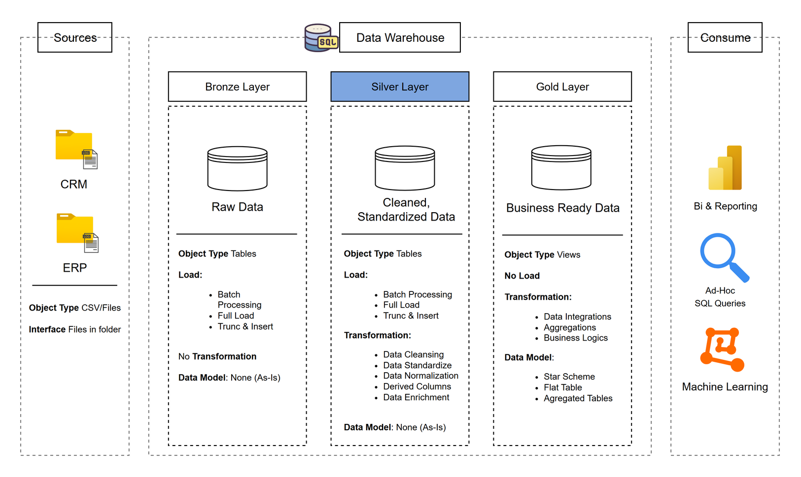

# 🏗️ SQL Data Warehouse Project

Building a modern data warehouse with **SQL Server**, using the **Medallion Architecture** (Bronze → Silver → Gold).
This project takes raw data from two business systems (**CRM** and **ERP**), cleans it, and turns it into a simple **star schema** that is ready for reporting and analysis.

> 💡 This is a portfolio project. It shows hands-on skills in **data engineering**, **ETL**, **data modeling** and **SQL development**.

---

## 📐 Data Architecture



The data moves through **three layers**. Each layer has one clear job:

| Layer | What it holds | Object Type | Load | Transformations |
|---|---|---|---|---|
| 🥉 **Bronze** | **Raw data**, copied as-is from the source CSV files | Tables | Batch, full load (truncate & insert) | None (as-is) |
| 🥈 **Silver** | **Cleaned and standardized** data | Tables | Batch, full load (truncate & insert) | Data cleansing, standardization, normalization, derived columns, data enrichment |
| 🥇 **Gold** | **Business-ready** data for reporting | Views | No load (views) | Data integration, aggregations, business logic → **Star Schema** |

**In simple words:**

1. **Sources** – CRM and ERP data arrive as CSV files in a folder.
2. **Bronze** – We load the files into SQL Server exactly as they are. This keeps a copy of the original data, so we can always trace back.
3. **Silver** – We fix the data: remove duplicates, trim spaces, fix invalid dates, make values consistent (for example `M` → `Male`).
4. **Gold** – We combine the clean tables into **dimension** and **fact** views that business users can easily query.
5. **Consume** – The Gold layer is used for **BI & reporting**, **ad-hoc SQL queries** and **machine learning**.

---

## ⭐ Data Model (Gold Layer)

The Gold layer is a **star schema** with one fact table and two dimension tables:

| View | Type | Description |
|---|---|---|
| `gold.dim_customers` | Dimension | Customer details with demographic and location data (country, gender, marital status, birth date). |
| `gold.dim_products` | Dimension | Current products with category, sub-category, product line and cost. |
| `gold.fact_sales` | Fact | Sales transactions (orders, dates, quantity, price, sales amount) linked to customers and products. |

```
gold.dim_customers ──┐
                     ├──< gold.fact_sales
gold.dim_products  ──┘
```

📖 Full column details are in the **[Data Catalog](docs/data_catalog.md)**.

---

## 🗃️ Datasets

The source data is included in the [`datasets/`](datasets) folder, so you can run the whole project yourself.

| Source System | File | What it contains | Loaded into |
|---|---|---|---|
| **CRM** | `cust_info.csv` | Customer details (name, gender, marital status, create date) | `bronze.crm_cust_info` |
| **CRM** | `prd_info.csv` | Product details (name, cost, product line, start/end dates) | `bronze.crm_prd_info` |
| **CRM** | `sales_details.csv` | Sales transactions (order number, dates, quantity, price, sales) | `bronze.crm_sales_details` |
| **ERP** | `CUST_AZ12.csv` | Extra customer data (birth date, gender) | `bronze.erp_cust_az12` |
| **ERP** | `LOC_A101.csv` | Customer location (country) | `bronze.erp_loc_a101` |
| **ERP** | `PX_CAT_G1V2.csv` | Product categories (category, sub-category, maintenance) | `bronze.erp_px_cat_g1v2` |

---

## 🎯 Project Goals

**Data Engineering**
- Import data from two source systems (ERP and CRM) given as CSV files.
- Clean the data and fix data quality issues before analysis.
- Combine both sources into one easy-to-use data model built for analytical queries.
- Focus on the latest dataset only (no history / historization needed).
- Write clear documentation for business users and analytics teams.

**Analytics & Reporting**
- Use SQL to answer business questions about:
  - **Customer behavior**
  - **Product performance**
  - **Sales trends**

---

## 📂 Repository Structure

```
sql-data-warehouse-project/
│
├── datasets/                          # Raw source data (CSV files)
│   ├── source_crm/                    # CRM system
│   │   ├── cust_info.csv
│   │   ├── prd_info.csv
│   │   └── sales_details.csv
│   └── source_erp/                    # ERP system
│       ├── CUST_AZ12.csv
│       ├── LOC_A101.csv
│       └── PX_CAT_G1V2.csv
│
├── docs/                              # Documentation and diagrams
│   ├── data_architecture.png          # Architecture image (shown above)
│   ├── data-architecture.drawio       # Architecture diagram (draw.io)
│   ├── data-flow-diagram.drawio       # Data flow / lineage diagram
│   ├── data-mart-star-schema.drawio   # Star schema diagram
│   └── data_catalog.md                # Gold layer data catalog
│
├── scripts/                           # SQL scripts
│   ├── init_database.sql              # Creates the database and schemas
│   ├── bronze/                        # Bronze layer: tables + load procedure
│   │   ├── ddl_bronze.sql
│   │   └── proc_load_bronze.sql
│   ├── silver/                        # Silver layer: tables + clean & load procedure
│   │   ├── ddl_silver.sql
│   │   └── proc_load_silver.sql
│   └── gold/                          # Gold layer: star schema views
│       └── ddl_gold.sql
│
├── tests/                             # Data quality checks
│   └── quality_checks_silver.sql
│
├── LICENSE
└── README.md
```

---

## 🚀 How to Run

**Requirements:** SQL Server (Express or Developer edition) and SQL Server Management Studio (SSMS).

**Get the project:** clone the repo (or download it as a ZIP from the green **Code** button).

```bash
git clone https://github.com/aiwithmubeen/sql-data-warehouse-project.git
```

Run the scripts in this order:

1. **Create the database and schemas**
   ```sql
   -- scripts/init_database.sql
   ```
2. **Bronze layer** – create the tables, then load the raw CSV files
   ```sql
   -- scripts/bronze/ddl_bronze.sql
   -- scripts/bronze/proc_load_bronze.sql
   EXEC bronze.load_bronze;
   ```
   > ⚠️ **Important:** `proc_load_bronze.sql` uses `BULK INSERT` with full file paths. Before running it, change every `FROM '...'` path so it points to the `datasets` folder on **your** machine, for example:
   > ```sql
   > FROM 'C:\sql-data-warehouse-project\datasets\source_crm\cust_info.csv'
   > ```
   > The SQL Server service must also have permission to read that folder.
3. **Silver layer** – create the tables, then clean and load the data
   ```sql
   -- scripts/silver/ddl_silver.sql
   -- scripts/silver/proc_load_silver.sql
   EXEC silver.load_silver;
   ```
4. **Gold layer** – create the star schema views
   ```sql
   -- scripts/gold/ddl_gold.sql
   ```
5. **Check data quality** (optional)
   ```sql
   -- tests/quality_checks_silver.sql
   ```

Now you can query the Gold layer:

```sql
-- Total sales by country
SELECT
    c.country,
    SUM(f.sales_amount) AS total_sales
FROM gold.fact_sales AS f
LEFT JOIN gold.dim_customers AS c
    ON f.customer_key = c.customer_key
GROUP BY c.country
ORDER BY total_sales DESC;
```

---

## 🛠️ Tools & Technologies

| Tool | Used for |
|---|---|
| **SQL Server** | Hosting the data warehouse |
| **SSMS** | Writing and running SQL scripts |
| **T-SQL** | ETL, stored procedures, views |
| **draw.io** | Architecture, data flow and data model diagrams |
| **Git & GitHub** | Version control and sharing the project |

---

## 📜 License

This project is licensed under the **[MIT License](LICENSE)**. You are free to use, change and share it with proper credit.

---

## 🙋 About Me

Hi, I'm **Mubeen** 👋 — I'm learning and building projects in **data engineering and analytics**.
If you like this project, please give it a ⭐ on GitHub!
